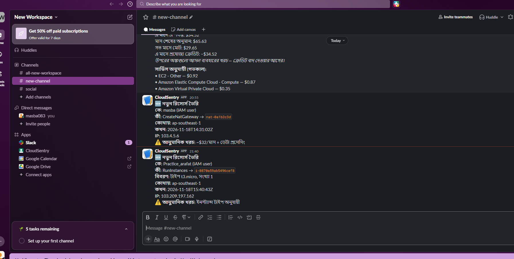
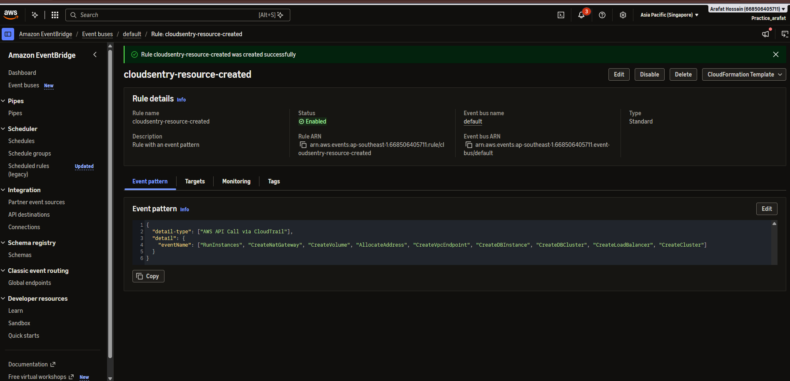
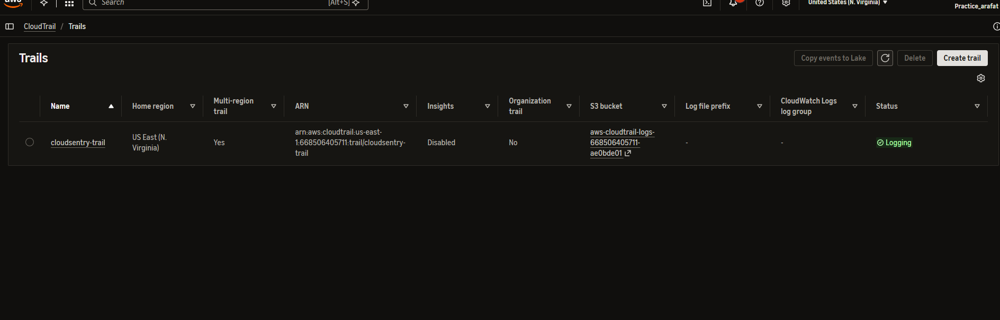
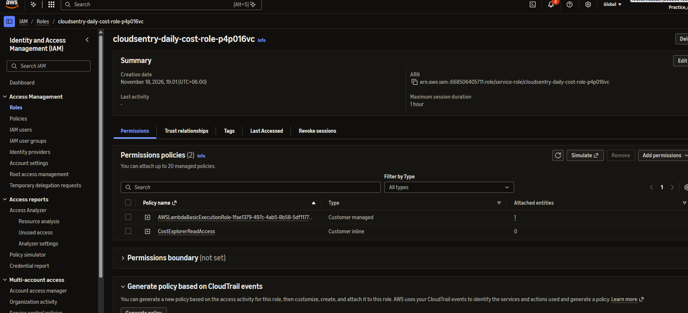
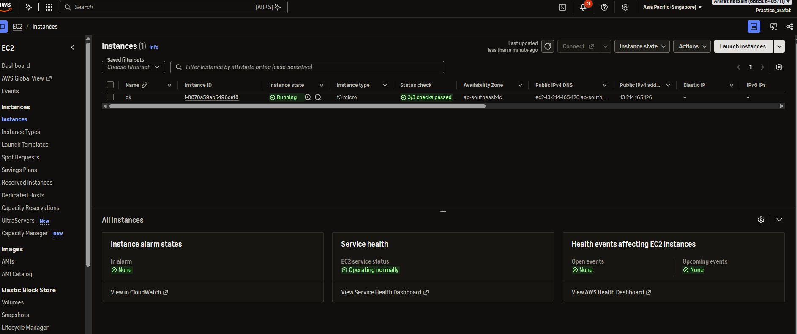

# AWS Cost Monitoring

Automated AWS cost reporting and real-time resource-creation alerting, delivered to Slack.

Built with AWS Lambda, Cost Explorer, CloudTrail and EventBridge. Internal project name: **CloudSentry**.

---

## Overview

Cloud spend becomes visible too late. AWS billing data refreshes roughly once every 24 hours, so a resource created in the morning does not appear in any cost report until the following day. Promotional credits make this worse: they offset usage inside the billing data itself, so an account consuming real money can report a balance of zero.

This project addresses both problems with two independent components.

| Component | Question answered | Trigger | Latency |
|---|---|---|---|
| Daily cost report | What was spent, and on which resources | Scheduled, once daily | Next day |
| Resource alert | Who created a billable resource, and where | CloudTrail event | Under one minute |

Both post to a Slack channel. Neither is sufficient alone: detection must be real-time, attribution can only be next-day.

---

## Features

- **Separates usage from credits.** Cost queries filter on `RECORD_TYPE = Usage`, so promotional credits do not mask actual consumption. Credits are reported on their own line.
- **Resource-level breakdown.** Costs are grouped by service and usage type in a single API call, so `EC2 - Other` resolves into specific line items such as `EBS:VolumeUsage.gp3` or `NatGateway-Hours`.
- **Month-end forecast on the same basis as actuals.** The forecast query uses the same filter as the cost queries, so the two figures are comparable.
- **Real-time creation alerts.** Covers EC2 instances, NAT gateways, EBS volumes, Elastic IPs, VPC endpoints, RDS instances and clusters, load balancers and EKS clusters.
- **Caller identity in every alert.** IAM users, assumed roles and root are distinguished; root activity is flagged explicitly.
- **Cost estimates in the alert.** Each resource type carries an approximate monthly cost so the reader can judge urgency immediately.
- **Loop protection.** The alert function ignores its own API calls and ignores failed API calls.
- **Runs for approximately $2 per month.**

---

## Sample output

### Daily cost report

```
AWS Cost Report - 2026-11-17
Yesterday: $2.14
Month to date: $34.52
Month-end forecast: $65.63
Last month total: $29.65
Credits applied this month: -$34.52
Figures above are real usage, before credits.

By service and usage type (yesterday):
- EC2 - Other - $0.92
        - APS1-EBS:VolumeUsage.gp3 - $0.71
        - APS1-EBS:SnapshotUsage - $0.21
- Amazon Elastic Compute Cloud - Compute - $0.87
        - APS1-BoxUsage:t3.small - $0.87
- Amazon Virtual Private Cloud - $0.35
        - APS1-PublicIPv4:InUseAddress - $0.35
```

### Resource creation alert

```
New resource created
Who: deploy-user (IAM user)
What: RunInstances -> i-0870a59ab5496cef8
Details: type t3.micro, count 1
Region: ap-southeast-1
When: 2026-11-18T15:40:43Z
Source IP: 203.0.113.10
Estimated cost: depends on instance type
```

---

## Screenshots

Daily cost report and resource alert in Slack. The credits line distinguishes invoiced amount from actual consumption; the indented entries under each service are the usage-type breakdown.



EventBridge rule, showing the event pattern that filters the CloudTrail stream down to resource-creation API calls, and the Lambda target.



CloudTrail trail, logging management events. A trail is required for EventBridge to receive CloudTrail events; the default Event history page does not satisfy this.



IAM policy attached to the reporting function. Read-only access to Cost Explorer, no other permissions.



Test instance used to verify the alert path end to end against a real resource rather than a synthetic test event.



---

## Architecture

**Component 1: Scheduled reporting (pull model)**

```
EventBridge Scheduler (daily)
    |
    v
Lambda: cloudsentry-daily-cost
    |
    v
Cost Explorer API  -->  Slack webhook
```

**Component 2: Event-driven alerting (push model)**

```
RunInstances / CreateNatGateway / CreateDBInstance / ...
    |
    v
CloudTrail (trail with management event logging enabled)
    |
    v
EventBridge default bus
    |
    v
EventBridge rule: cloudsentry-resource-created
    |
    v
Lambda: cloudsentry-resource-alerts  -->  Slack webhook
```

### Design rationale

Cost Explorer and CloudTrail answer different questions and operate on different timescales.

Cost Explorer holds monetary values but is not real-time; billing data is refreshed approximately once per day. CloudTrail is near real-time and records caller identity, but contains no cost information.

Using only the cost report means waste is discovered after it has been paid for. Using only CloudTrail means knowing a resource was created without knowing what it costs. The two components together provide real-time detection and next-day attribution.

---

## Engineering notes

Issues encountered during development, with root cause and resolution. Documented because each one is a non-obvious property of the AWS services involved.

### 1. All cost figures reported as zero

**Observation.** Daily, month-to-date and previous-month figures all returned `$-0.00`, while the month-end forecast returned `$31.11`. The two outputs were mutually inconsistent.

**Root cause.** The Cost Explorer query applied no record-type filter. Promotional credits are returned as negative line items, so usage of `+$34.52` and credits of `-$34.52` summed to approximately zero. The negative sign on `$-0.00` indicated a small residual negative value rather than a true zero, which confirmed credits were in play rather than genuinely absent usage.

**Resolution.** Filter every cost query on `RECORD_TYPE = Usage`. This dimension is labelled **Charge Type** in the Cost Explorer console, which is why the mapping is easy to miss when moving from console to API.

```python
"Filter": {
    "Dimensions": {
        "Key": "RECORD_TYPE",
        "Values": ["Usage", "DiscountedUsage", "SavingsPlanCoveredUsage"]
    }
}
```

`DiscountedUsage` and `SavingsPlanCoveredUsage` are included because Reserved Instance and Savings Plan consumption is genuine usage. Omitting them would under-report any account holding commitments.

A separate query against `Credit` and `Refund` was added so the quantity of credit being consumed appears as its own reported figure.

### 2. Forecast inconsistent with actuals

**Observation.** Actual spend reported as zero while the forecast reported a non-zero figure.

**Root cause.** The record-type filter had been applied to `get_cost_and_usage` but not to `get_cost_forecast`. The two calls were computing on different bases.

**Resolution.** Apply the same filter to both calls. The forecast call is additionally wrapped in exception handling, because accounts with insufficient billing history cannot be forecast at all; a missing forecast degrades one line of the report rather than failing it.

### 3. Negative zero in formatted output

**Observation.** Output rendered as `$-0.00`.

**Root cause.** Values such as `-0.0000037` round to `-0.00` at two decimal places.

**Resolution.** Normalise any value below half a cent to exactly zero before formatting.

```python
def _money(value):
    return 0.0 if abs(value) < 0.005 else round(value, 2)
```

### 4. EventBridge rule never triggered

**Observation.** The rule was created and enabled, and the target Lambda executed correctly when invoked manually, but creating a real resource produced no invocation.

**Root cause.** CloudTrail **Event history** is enabled by default and displays all API activity, but it is not a trail. Events with a detail-type of `AWS API Call via CloudTrail` are only delivered to EventBridge when the account has a trail actively logging management or data events.

**Resolution.** Create a trail logging management events. The first copy of management events is delivered at no charge, so the only ongoing cost is S3 storage for the log files.

### 5. Alert not received for a resource created in another region

**Observation.** An EC2 instance was launched and no alert arrived.

**Root cause.** The instance was created in `ap-south-1` while the EventBridge rule and Lambda were deployed in `ap-southeast-1`. EventBridge is a regional service, and a CloudTrail event is delivered to the event bus in the region where the API call originated.

**Resolution for this deployment.** Create resources in the same region as the rule.

**Resolution for production.** See Known limitations. Note that enabling a multi-region trail does not resolve this: multi-region controls where log files are aggregated for storage, not which regional event bus receives the event.

### 6. Potential invocation loop

**Risk.** Planned auto-tagging work will cause the alert function to make its own AWS API calls, which CloudTrail records. A sufficiently broad event pattern would cause the function to alert on its own activity and re-trigger itself.

**Mitigation.** Two independent guards. The event pattern enumerates specific `eventName` values rather than matching a service wildcard, and the handler returns early when the calling identity matches its own execution role.

### 7. Cost Explorer API request pricing

**Constraint.** Each Cost Explorer API request is billed at $0.01.

The initial approach to the usage-type breakdown issued one additional request per service. At three services that is three extra requests per day on top of the five the report already makes, adding roughly $1 per month to an account spending $65 per month.

**Resolution.** Cost Explorer accepts up to two `GroupBy` dimensions per request. Requesting `SERVICE` and `USAGE_TYPE` together returns the full breakdown in a single call.

```python
"GroupBy": [
    {"Type": "DIMENSION", "Key": "SERVICE"},
    {"Type": "DIMENSION", "Key": "USAGE_TYPE"}
]
```

### 8. Cost concentration in "EC2 - Other"

Not a defect, but the reason the usage-type breakdown is necessary.

`Amazon Elastic Compute Cloud - Compute` covers instance hours only. Resources attached to an instance are billed separately under `EC2 - Other`, which includes EBS volumes, EBS snapshots, NAT Gateway hours and data processing, and certain data transfer. An instance reported at $200 under Compute may represent $290 of total cost once `EC2 - Other` is attributed to it.

EBS volumes are the common case: they can survive instance termination and continue to bill indefinitely.

Separately, charges appearing under `Amazon Virtual Private Cloud` are typically public IPv4 addresses. AWS has charged approximately $0.005 per hour per public IPv4 address since 2024, whether or not the address is in use. An unattached Elastic IP costs roughly $3.60 per month.

---

## Deployment

Console-based deployment, no infrastructure-as-code. Approximate time: 45 minutes.

### Prerequisites

- An AWS account with administrative access
- A Slack workspace in which an incoming webhook can be created
- A single target region. This guide uses `ap-southeast-1`. All resources must be deployed in the same region.

### Step 0 — Create the Slack webhook

1. Open https://api.slack.com/apps and select **Create New App** → **From scratch**
2. Name the app and select the target workspace
3. Open **Incoming Webhooks** and enable it
4. Select **Add New Webhook to Workspace**, choose the destination channel, and authorise
5. Copy the webhook URL

The webhook URL is a credential. It is supplied to each function as an environment variable and is never committed to source control.

### Step 1 — Enable Cost Explorer

Navigate to **Billing and Cost Management** → **Cost Explorer** and enable it if not already active. On a new account, data may take up to 24 hours to become available.

### Step 2 — Deploy the reporting function

1. **Lambda** → **Create function** → **Author from scratch**
2. Function name: `cloudsentry-daily-cost`
3. Runtime: Python 3.13 or later
4. Replace the generated handler with the contents of [`src/daily-cost-report/lambda_function.py`](src/daily-cost-report/lambda_function.py) and select **Deploy**
5. **Configuration** → **Environment variables**: add `SLACK_WEBHOOK_URL`
6. **Configuration** → **General configuration**: set **Timeout** to 1 minute

The default 3-second timeout is insufficient. This function issues five Cost Explorer requests per invocation.

### Step 3 — Grant Cost Explorer read access

1. **Configuration** → **Permissions** → open the execution role
2. **Add permissions** → **Create inline policy** → **JSON**
3. Apply [`policies/cost-explorer-read-policy.json`](policies/cost-explorer-read-policy.json)
4. Name the policy `CostExplorerReadAccess`

Cost Explorer does not support resource-level permissions, so `"Resource": "*"` is required. The policy grants read access only.

### Step 4 — Verify the reporting function

Create a test event named `manual-run` with body `{}` and invoke it. Expected result: HTTP 200, the full report written to the execution log, and a message delivered to Slack.

An `AccessDeniedException` on first invocation usually indicates IAM propagation delay; retry after ten seconds.

### Step 5 — Schedule the report

1. On the function page select **Add trigger** → **EventBridge (CloudWatch Events)** → **Create a new rule**
2. Name: `cloudsentry-daily-schedule`
3. Rule type: **Schedule expression**
4. Expression: `cron(0 3 * * ? *)`

Schedule the report several hours after midnight UTC so the previous day's billing data has settled.

### Step 6 — Create a CloudTrail trail

Required. Without an active trail, EventBridge receives no CloudTrail events and the alerting component will not function.

1. **CloudTrail** → **Trails** → **Create trail**
2. Trail name: `cloudsentry-trail`
3. Accept the S3 bucket AWS offers to create
4. Management events: **Write** only
5. Data events: disabled

Confirm the trail status reads **Logging**.

Recommended: apply an S3 lifecycle rule to the log bucket expiring objects after 30 days.

### Step 7 — Deploy the alerting function

1. **Lambda** → **Create function** → **Author from scratch**
2. Function name: `cloudsentry-resource-alerts`
3. Runtime: Python 3.13 or later
4. Apply [`src/resource-alerts/lambda_function.py`](src/resource-alerts/lambda_function.py) and **Deploy**
5. **Configuration** → **Environment variables**: add `SLACK_WEBHOOK_URL`
6. **Configuration** → **General configuration**: set **Timeout** to 30 seconds

No additional IAM permissions are required. The function reads the event it is passed and issues one outbound HTTPS request.

### Step 8 — Verify the alerting function

Create a test event named `nat-sample` using [`policies/sample-test-event.json`](policies/sample-test-event.json) and invoke it. The sample event uses clearly synthetic identifiers so test output cannot be mistaken for a real resource.

This verifies the function and the Slack integration only. It does not verify event delivery, which is covered in Step 10.

### Step 9 — Create the EventBridge rule

1. **EventBridge** → **Event buses** → **default** → **Rules** → **Create rule**
2. If a builder mode selector is presented, choose **Advanced builder**
3. Name: `cloudsentry-resource-created`; Event bus: **default**; Rule type: **Rule with an event pattern**
4. Event source: **Other**; Creation method: **Custom pattern (JSON editor)**
5. Apply [`policies/eventbridge-rule-pattern.json`](policies/eventbridge-rule-pattern.json)
6. Target type: **AWS service** → **Lambda function** → `cloudsentry-resource-alerts`
7. Execution role: **Create default role**
8. Create the rule

In recent console versions, rules are managed within the event bus rather than from the top-level navigation. EventBridge provisions the Lambda invocation permission automatically.

### Step 10 — End-to-end verification

1. Confirm the console region matches the rule region
2. Launch a `t3.micro` instance
3. Confirm the alert is delivered to Slack
4. Terminate the instance
5. Confirm under **EC2** → **Volumes** that the attached volume was deleted

Step 5 is not optional. Instance termination does not always delete the root volume, and orphaned volumes continue to bill under `EC2 - Other`.

---

## Known limitations

**Single-region alert coverage.** EventBridge is regional and CloudTrail events are delivered to the bus in the originating region. Resources created outside the deployment region produce no alert. The production solution is a forwarding rule in each active region targeting a central event bus in the primary region, after which one function handles all regions. Note also that global services such as IAM emit events to `us-east-1` regardless of where the caller is operating.

**Billing data latency.** Cost data lags by up to 24 hours. This is a property of AWS billing and is the reason the alerting component exists.

**No per-identity cost attribution.** The alert identifies who created a resource; the report identifies what was spent. The two are not currently joined. Joining them requires tagging resources with `Owner` and `Project`, activating those keys as cost allocation tags, and grouping the Cost Explorer query by `TAG` rather than `SERVICE`. The planned approach is to have the alerting function apply the `Owner` tag automatically from the caller identity already present in the CloudTrail event, which removes the dependency on manual tagging discipline. Two constraints apply: cost allocation tags are not retroactive, and tag data takes approximately 24 hours to appear in billing data.

**No per-resource cost.** Reporting resolves to usage type, not individual resource ID. Per-resource cost requires either resource-level data in Cost Explorer preferences, which covers the trailing 14 days and is billed per usage record, or CUR 2.0 exported to S3 and queried with Athena, which carries no retention limit.

**No infrastructure-as-code.** This deployment is console-based by design, to establish the dependencies between components before abstracting them. A Terraform module is the next planned milestone.

---

## Operating cost

| Item | Monthly |
|---|---|
| Cost Explorer API, approximately 6 requests per day at $0.01 | ~$1.80 |
| Lambda invocations | within free tier |
| CloudTrail management events, first copy | $0.00 |
| S3 storage for trail logs | under $0.10 |
| **Total** | **approximately $2.00** |

Cost Explorer API pricing is the reason the reporting function batches its queries using two-dimension grouping rather than issuing one request per service.

---

## Repository layout

```
.
├── README.md
├── LICENSE
├── .gitignore
├── src
│   ├── daily-cost-report
│   │   └── lambda_function.py
│   └── resource-alerts
│       └── lambda_function.py
├── policies
│   ├── cost-explorer-read-policy.json
│   ├── eventbridge-rule-pattern.json
│   └── sample-test-event.json
└── screenshots
```

---

## Security

- The Slack webhook URL is held in a Lambda environment variable and excluded from source control via `.gitignore`. For production use it should be moved to AWS Secrets Manager or SSM Parameter Store and retrieved at runtime.
- Both execution roles follow least privilege. The reporting function holds read-only Cost Explorer access; the alerting function holds no permissions beyond CloudWatch Logs.
- Root user activity is identified explicitly in alert output. Root credentials should not be used for routine operations, so an alert attributed to root warrants review.
- The sample test event in this repository contains synthetic account identifiers and resource IDs only.

---

## Roadmap

- Terraform module covering the full stack
- Automatic `Owner` tagging from CloudTrail caller identity, with cost reporting grouped by tag
- Cross-region event forwarding to a central event bus
- AWS Budgets threshold alerts and Cost Anomaly Detection routed to the same Slack channel
- Weekly top-20 most expensive resources, sourced from CUR 2.0 via Athena

---

## License

MIT. See [LICENSE](LICENSE).
