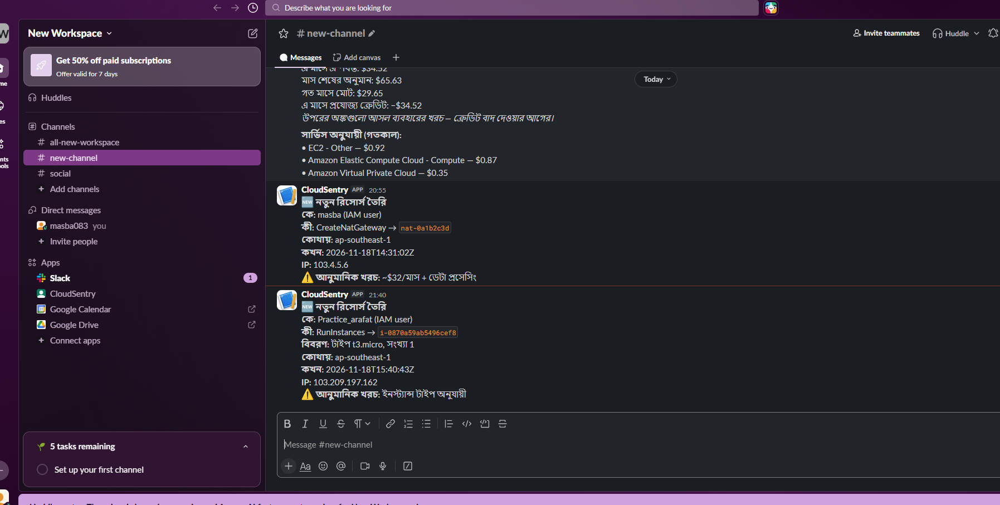
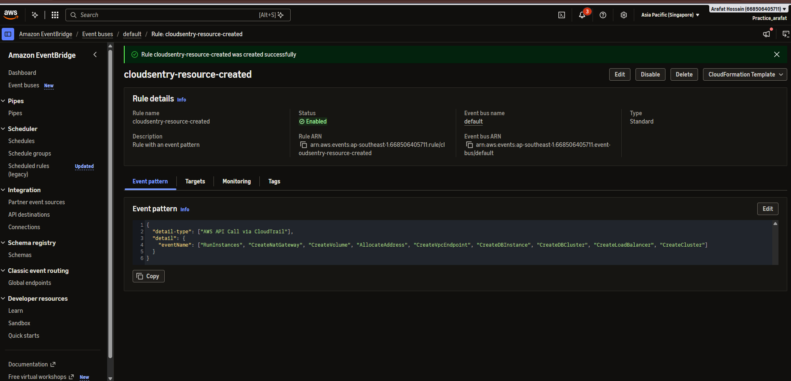
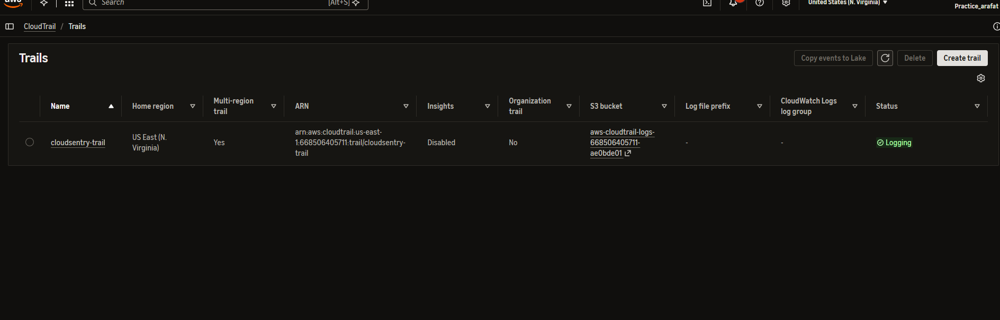
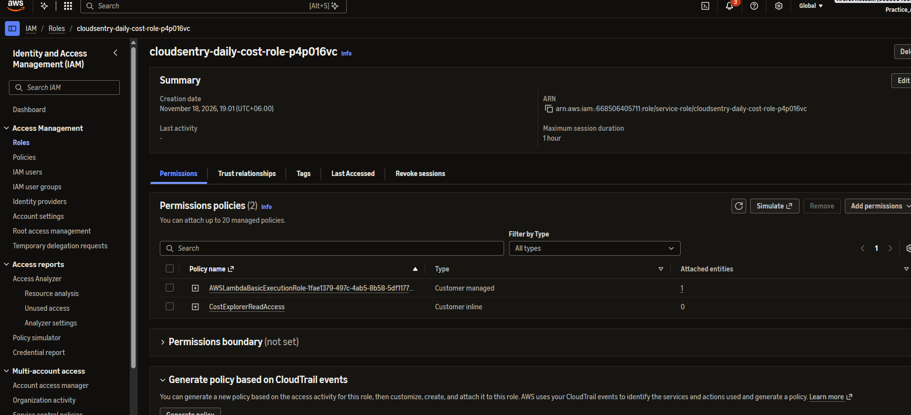
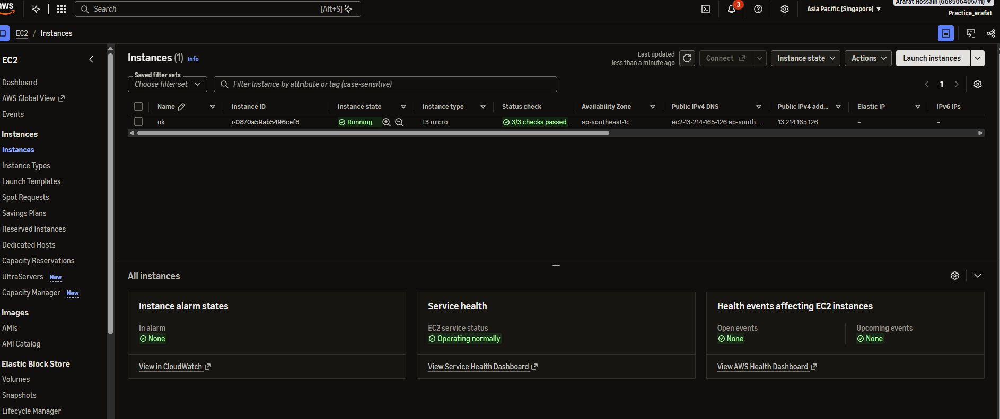

# AWS Cost Monitoring

Automated AWS cost reporting and real-time resource-creation alerting, delivered to Slack.

Built with AWS Lambda, Cost Explorer, CloudTrail and EventBridge. Internal project name: **CloudSentry**.

---

## Summary

AWS cost problems are usually discovered too late. Billing data refreshes roughly once every 24 hours, so a resource created in the morning does not appear in any cost report until the following day. Promotional credits make this worse: credits offset usage inside the billing data itself, so an account consuming real money can report a balance of zero.

This project addresses both with two independent components.

| Component | Question answered | Trigger | Latency |
|---|---|---|---|
| Daily cost report | What was spent, and on which resources | Scheduled, once daily | Next day |
| Resource alert | Who created a billable resource, and where | CloudTrail event | Under one minute |

Both deliver to a Slack channel. Neither is sufficient alone: detection has to be real-time, attribution can only be next-day.

**Result on the account this was built against.** Before the record-type filter was applied, every figure in the report read `$0.00`. After it, the same account showed approximately **$34 per month of real consumption** that credits had been masking, with a projected run rate of **$65 per month** once those credits are exhausted. The usage-type breakdown then identified which specific resources accounted for it.

---

## Features

- **Separates usage from credits.** Every cost query filters on `RECORD_TYPE = Usage`, so promotional credits cannot mask actual consumption. Credits are reported on their own line.
- **Resource-level breakdown.** Costs are grouped by service *and* usage type in a single API call, so `EC2 - Other` resolves into concrete line items such as `EBS:VolumeUsage.gp3` or `NatGateway-Hours`.
- **Forecast computed on the same basis as actuals.** The forecast query applies the same filter as the cost queries, so the two figures are directly comparable.
- **Real-time creation alerts** for EC2 instances, NAT gateways, EBS volumes, Elastic IPs, VPC endpoints, RDS instances and clusters, load balancers and EKS clusters.
- **Caller identity in every alert.** IAM users, assumed roles and root are distinguished, and root activity is flagged explicitly.
- **Cost estimate attached to each alert**, so the reader can judge urgency without opening the console.
- **Loop protection.** The alert function ignores its own API calls and ignores failed API calls.
- **No external dependencies.** Both functions use only the Python standard library and `boto3`, which the Lambda runtime provides. No packaging step, no layers, no `pip install`.
- **Runs for approximately $2 per month.**

---

## Sample output

### Daily cost report

```
AWS Cost Report - 2026-11-17
Yesterday: $2.14
Month to date: $34.52
Month-end forecast: $65.63
Last month total: $29.65
Credits applied this month: -$34.52
Figures above are real usage, before credits.

By service and usage type (yesterday):
- EC2 - Other - $0.92
        - APS1-EBS:VolumeUsage.gp3 - $0.71
        - APS1-EBS:SnapshotUsage - $0.21
- Amazon Elastic Compute Cloud - Compute - $0.87
        - APS1-BoxUsage:t3.small - $0.87
- Amazon Virtual Private Cloud - $0.35
        - APS1-PublicIPv4:InUseAddress - $0.35
```

### Resource creation alert

```
New resource created
Who: deploy-user (IAM user)
What: RunInstances -> i-0870a59ab5496cef8
Details: type t3.micro, count 1
Region: ap-southeast-1
When: 2026-11-18T15:40:43Z
Source IP: 203.0.113.10
Estimated cost: depends on instance type
```

---

## Screenshots

Daily cost report and resource alert in Slack. The credits line distinguishes the invoiced amount from actual consumption; the indented entries under each service are the usage-type breakdown.



EventBridge rule, showing the event pattern that filters the CloudTrail stream down to resource-creation API calls, and the Lambda target.



CloudTrail trail, logging management events. A trail is required for EventBridge to receive CloudTrail events; the default Event history page does not satisfy this.



IAM policy attached to the reporting function. Read-only access to Cost Explorer, no other permissions.



Test instance used to verify the alert path end to end against a real resource rather than a synthetic test event.



---

## Architecture

**Component 1 — Scheduled reporting (pull model)**

```
EventBridge Scheduler (daily)
    |
    v
Lambda: cloudsentry-daily-cost
    |
    v
Cost Explorer API  -->  Slack webhook
```

**Component 2 — Event-driven alerting (push model)**

```
RunInstances / CreateNatGateway / CreateDBInstance / ...
    |
    v
CloudTrail (trail with management event logging enabled)
    |
    v
EventBridge default bus
    |
    v
EventBridge rule: cloudsentry-resource-created
    |
    v
Lambda: cloudsentry-resource-alerts  -->  Slack webhook
```

### Why two components

Cost Explorer and CloudTrail answer different questions on different timescales.

Cost Explorer holds monetary values but is not real-time; billing data refreshes approximately once per day. CloudTrail is near real-time and records caller identity, but contains no cost information at all.

Using only the cost report means waste is found after it has been paid for. Using only CloudTrail means knowing a resource exists without knowing what it costs. Together: **real-time detection, next-day attribution.**

---

## How it works

Useful if you are reading the code, or rebuilding this from scratch.

### Reporting function — `src/daily-cost-report/lambda_function.py`

Five Cost Explorer requests per invocation:

| Request | Purpose |
|---|---|
| `get_cost_and_usage` grouped by `SERVICE` + `USAGE_TYPE` | Yesterday's spend, broken down |
| `get_cost_and_usage` | Month to date |
| `get_cost_and_usage` | Previous month total |
| `get_cost_and_usage` filtered to `Credit` / `Refund` | Credits consumed this month |
| `get_cost_forecast` | Projected spend for the remainder of the month |

Key points in the implementation:

- The Cost Explorer client is always created against `us-east-1`. Cost Explorer has no regional endpoints, regardless of where the function itself runs.
- All date ranges are half-open: `TimePeriod` end dates are exclusive.
- Pagination is handled via `NextPageToken` on every query.
- The month-end figure is month-to-date plus the forecast for the remaining days, not the forecast alone.
- `_money()` normalises any value below half a cent to exactly zero, which prevents `$-0.00` appearing in output.
- Services and usage types below `$0.01` are omitted, so the report stays readable.

### Alerting function — `src/resource-alerts/lambda_function.py`

Invoked by EventBridge with a CloudTrail event. Steps, in order:

1. Return early if the event carries an `errorCode` — a failed API call created nothing.
2. Return early if the calling identity contains the self-marker — this prevents the function alerting on its own activity.
3. Resolve the caller from `userIdentity`, handling `IAMUser`, `AssumedRole`, `Root` and `AWSService`.
4. Extract the resource identifier. Every AWS API places this somewhere different, so each event type is mapped explicitly, with a generic fallback so unmapped events still produce a usable message.
5. Attach an approximate monthly cost for the resource type.
6. Post to Slack.

Adding support for a new resource type means adding one entry to the `lookups` dictionary and one entry to the event pattern. Nothing else changes.

---

## Deployment

Console-based, no infrastructure-as-code. Approximately 45 minutes.

### Prerequisites

- An AWS account with administrative access
- A Slack workspace where you can create an incoming webhook
- **A single target region.** This guide uses `ap-southeast-1`. Every resource below must be in the same region — see Known limitations for why this matters.

No local tooling is required. Everything is done in the browser.

### Step 0 — Create the Slack webhook

1. Open https://api.slack.com/apps → **Create New App** → **From scratch**
2. Name the app and select your workspace
3. Open **Incoming Webhooks** and enable it
4. **Add New Webhook to Workspace** → choose the destination channel → authorise
5. Copy the webhook URL

The webhook URL is a credential. Anyone holding it can post into your channel. It is supplied to each function as an environment variable and must never be committed to source control.

### Step 1 — Enable Cost Explorer

**Billing and Cost Management** → **Cost Explorer** → enable if not already active.

On a brand new account, data can take up to 24 hours to appear.

### Step 2 — Deploy the reporting function

1. **Lambda** → **Create function** → **Author from scratch**
2. Function name: `cloudsentry-daily-cost`
3. Runtime: Python 3.13 or later
4. **Create function**
5. Replace the generated handler with the full contents of [`src/daily-cost-report/lambda_function.py`](src/daily-cost-report/lambda_function.py)
6. **Deploy**
7. **Configuration** → **Environment variables** → add key `SLACK_WEBHOOK_URL` with your webhook URL
8. **Configuration** → **General configuration** → set **Timeout** to **1 minute**

The default 3-second timeout is far too short. This function issues five Cost Explorer requests per invocation.

### Step 3 — Grant Cost Explorer read access

1. **Configuration** → **Permissions** → open the execution role
2. **Add permissions** → **Create inline policy** → **JSON**
3. Paste [`policies/cost-explorer-read-policy.json`](policies/cost-explorer-read-policy.json)
4. Name it `CostExplorerReadAccess` → **Create policy**

Cost Explorer does not support resource-level permissions, so `"Resource": "*"` is required. The policy grants read access only.

### Step 4 — Verify the reporting function

Create a test event named `manual-run` with body `{}` and invoke it.

Expected: `"statusCode": 200`, the full report in the execution log, and a message in Slack.

An `AccessDeniedException` on the first attempt usually means IAM has not propagated yet. Wait ten seconds and retry.

### Step 5 — Schedule the report

1. On the function page → **Add trigger** → **EventBridge (CloudWatch Events)** → **Create a new rule**
2. Name: `cloudsentry-daily-schedule`
3. Rule type: **Schedule expression**
4. Expression: `cron(0 3 * * ? *)`

That is 03:00 UTC. Schedule it a few hours after midnight UTC so the previous day's billing data has settled.

### Step 6 — Create a CloudTrail trail

**This step is mandatory and easy to skip.** Without an active trail, EventBridge receives no CloudTrail events and the alerting component silently does nothing.

1. **CloudTrail** → **Trails** → **Create trail**
2. Trail name: `cloudsentry-trail`
3. Accept the S3 bucket AWS offers to create
4. Management events: **Write** only — Read events are high volume and not needed here
5. Data events: **disabled** — this is where CloudTrail bills become expensive

Confirm the Status column reads **Logging**.

Recommended: open the log bucket → **Management** → **Create lifecycle rule** → expire objects after 30 days.

### Step 7 — Deploy the alerting function

1. **Lambda** → **Create function** → **Author from scratch**
2. Function name: `cloudsentry-resource-alerts`
3. Runtime: Python 3.13 or later
4. Paste [`src/resource-alerts/lambda_function.py`](src/resource-alerts/lambda_function.py) → **Deploy**
5. **Configuration** → **Environment variables** → add `SLACK_WEBHOOK_URL`
6. **Configuration** → **General configuration** → **Timeout: 30 seconds**

No additional IAM permissions are required. The function reads the event it is handed and makes one outbound HTTPS request.

### Step 8 — Verify the alerting function

Create a test event named `nat-sample` using [`policies/sample-test-event.json`](policies/sample-test-event.json) and invoke it.

The sample event uses obviously synthetic identifiers (`nat-SAMPLE-NOT-REAL`, `SAMPLE-USER`) so test output can never be mistaken for a real resource.

This verifies the function and the Slack integration only. It does **not** verify event delivery, because you invoked the function yourself. That is Step 10.

### Step 9 — Create the EventBridge rule

1. **EventBridge** → **Event buses** → click **default** → **Rules** tab → **Create rule**
   - In recent console versions, rules live inside the bus rather than in the left-hand navigation
2. If a **Builder mode** selector appears, choose **Advanced builder**
3. Name: `cloudsentry-resource-created`; Event bus: **default**; Rule type: **Rule with an event pattern** → **Next**
4. Event source: **Other**
5. Creation method: **Custom pattern (JSON editor)**
6. Paste [`policies/eventbridge-rule-pattern.json`](policies/eventbridge-rule-pattern.json) and confirm it reports **JSON is valid** → **Next**
7. Target types: **AWS service** → Select a target: **Lambda function** → Function: `cloudsentry-resource-alerts`
8. Execution role: leave on **Create default role** → **Next** → **Next** → **Create rule**

EventBridge provisions its own permission to invoke the Lambda automatically.

### Step 10 — End-to-end verification

1. Confirm the console region matches the rule's region
2. **EC2** → **Launch instance** → `t3.micro` → launch
3. Watch Slack — the alert should arrive within a minute or two
4. **Terminate** the instance
5. **EC2** → **Volumes** → confirm the attached volume was deleted with it

**The volume check is not optional.** Terminating an instance does not always delete its root volume, and an orphaned volume keeps billing under `EC2 - Other` indefinitely — exactly the problem this project exists to surface.

---

## Troubleshooting

### The report posts, but every figure is $0.00

Either the account genuinely has no usage, or credits are absorbing it. Check whether the "Credits applied this month" line appears. If it does, credits are covering the spend and the figures above that line are the real consumption. If the line is absent and everything is still zero, the usage is covered by Free Tier, which is not charged at all and therefore never appears as cost.

### The report posts, but the forecast says "not available"

AWS could not produce a forecast, usually because the account has too little billing history. The function catches this and degrades one line rather than failing. It resolves itself once there is more history.

### Lambda times out

Raise the timeout. The reporting function needs around 4 seconds in a small account; 1 minute gives headroom for larger ones, where daily granularity returns many more buckets.

### `AccessDeniedException` on `ce:GetCostAndUsage`

The inline policy from Step 3 is either missing, or attached to the wrong role, or has not propagated yet. Confirm you attached it to the execution role shown under **Configuration** → **Permissions** for that specific function.

### No alert when a resource is created

Work through these in order:

1. **Is there a CloudTrail trail with status Logging?** Event history alone is not enough. This is the most common cause.
2. **Was the resource created in the same region as the rule?** EventBridge is regional. A resource created in another region produces no alert.
3. **Is the rule Enabled?** Check the rule's status on the EventBridge page.
4. **Did the Lambda get invoked?** Open the function → **Monitor** → **Invocations**. If the graph shows activity, the wiring works and the problem is in the function or in Slack. If it is flat, the event never reached the function.
5. **Is the event name in the pattern?** The rule only matches the API names listed in `eventbridge-rule-pattern.json`.

CloudTrail delivery normally takes a minute or two, occasionally longer. Give it five minutes before concluding it has failed.

### Slack receives nothing, but the Lambda returned 200

The `SLACK_WEBHOOK_URL` environment variable is probably pointing at a webhook that has been revoked, or at the wrong channel. Webhooks are bound to a single channel at creation time.

---

## Customization

### Change the alerted resource types

Edit `policies/eventbridge-rule-pattern.json`, add the API name to the `eventName` list, and update the rule in the console. To get a readable resource ID in the message, add a matching entry to the `lookups` dictionary in `src/resource-alerts/lambda_function.py`. Without that entry the alert still fires and falls back to a generic identifier.

### Change the report schedule

Edit the cron expression on the `cloudsentry-daily-schedule` rule. Cron expressions in EventBridge are in UTC.

### Change the reporting thresholds

`SERVICE_THRESHOLD` and `USAGE_TYPE_THRESHOLD` in the reporting function control what is small enough to omit. `TOP_N_SERVICES` and `TOP_N_USAGE_TYPES` cap how many lines are printed.

### Change the message language or format

All output strings are built in `build_report()` and `build_message()`. Nothing else needs to change to translate or restyle the messages.

### Adjust the cost estimates in alerts

`COST_HINTS` in the alerting function maps API names to an approximate monthly cost. These are rough figures for `ap-southeast-1` and should be adjusted for your region.

---

## Engineering notes

Issues encountered during development, with root cause and resolution. Documented because each is a non-obvious property of the AWS services involved, and each one cost time to find.

### 1. All cost figures reported as zero

**Observation.** Daily, month-to-date and previous-month figures all returned `$-0.00`, while the month-end forecast returned `$31.11`. The two outputs were mutually inconsistent, which meant at least one of them was wrong.

**Root cause.** The Cost Explorer query applied no record-type filter. Promotional credits are returned as negative line items, so usage of `+$34.52` and credits of `-$34.52` summed to approximately zero. The negative sign on `$-0.00` was the diagnostic clue: a true zero carries no sign, so the real value was a small residual negative, which is what credits slightly exceeding usage produces after rounding.

**Resolution.** Filter every cost query on `RECORD_TYPE = Usage`. This dimension is labelled **Charge Type** in the Cost Explorer console, which is why the mapping is easy to miss when moving from console to API.

```python
"Filter": {
    "Dimensions": {
        "Key": "RECORD_TYPE",
        "Values": ["Usage", "DiscountedUsage", "SavingsPlanCoveredUsage"]
    }
}
```

`DiscountedUsage` and `SavingsPlanCoveredUsage` are included because Reserved Instance and Savings Plan consumption is genuine usage. Omitting them would under-report any account holding commitments.

A separate query against `Credit` and `Refund` was added so the amount of credit being consumed is reported explicitly. That figure is what tells you how much runway is left.

### 2. Forecast inconsistent with actuals

**Observation.** Actual spend reported as zero while the forecast reported a non-zero figure.

**Root cause.** The record-type filter had been applied to `get_cost_and_usage` but not to `get_cost_forecast`. The two calls were computing on different bases, so the numbers could not be compared.

**Resolution.** Apply the same filter to both. The forecast call is additionally wrapped in exception handling, because accounts with insufficient billing history cannot be forecast at all. A missing forecast should degrade one line of the report, not fail the whole invocation.

### 3. Negative zero in formatted output

**Observation.** Output rendered as `$-0.00`.

**Root cause.** Values such as `-0.0000037` round to `-0.00` at two decimal places.

**Resolution.** Normalise any value below half a cent to exactly zero before formatting.

```python
def _money(value):
    return 0.0 if abs(value) < 0.005 else round(value, 2)
```

Cosmetic, but worth fixing: the stray minus sign was the clue that led to issue 1, and leaving it in makes correct output look broken.

### 4. EventBridge rule never triggered

**Observation.** The rule was created and enabled, the target Lambda executed correctly when invoked manually, but creating a real resource produced no invocation at all.

**Root cause.** CloudTrail **Event history** is enabled by default, is free, and displays all API activity — so it is natural to assume it is sufficient. It is not. Events with a detail-type of `AWS API Call via CloudTrail` are only delivered to EventBridge when the account has a trail actively logging management or data events.

**Resolution.** Create a trail logging management events. The first copy of management events is delivered at no charge, so the only ongoing cost is S3 storage for the log files.

### 5. No alert for a resource created in another region

**Observation.** An EC2 instance was launched and no alert arrived, despite the system working when tested by hand.

**Root cause.** The instance was created in `ap-south-1` while the rule and Lambda were deployed in `ap-southeast-1`. EventBridge is a regional service, and a CloudTrail event is delivered to the event bus in the region where the API call originated.

**Resolution for this deployment.** Create resources in the same region as the rule.

**Resolution for production.** See Known limitations. Note that enabling a multi-region trail does not solve this: multi-region controls where log files are aggregated for storage, not which regional event bus receives the event.

### 6. Potential invocation loop

**Risk.** The planned auto-tagging work will cause the alert function to make its own AWS API calls, which CloudTrail records. A sufficiently broad event pattern would cause the function to alert on its own activity, re-trigger itself, and continue indefinitely.

**Mitigation.** Two independent guards. The event pattern enumerates specific `eventName` values rather than matching a service wildcard, and the handler returns early when the calling identity matches its own execution role.

### 7. Cost Explorer API request pricing

**Constraint.** Each Cost Explorer API request is billed at $0.01.

The initial approach to the usage-type breakdown issued one additional request per service. At three services that is three extra requests per day on top of the five the report already makes, adding roughly $1 per month to an account spending $65 per month. Not large in absolute terms, but a cost monitoring tool that quietly grows its own bill is a poor advertisement for itself.

**Resolution.** Cost Explorer accepts up to two `GroupBy` dimensions per request. Requesting `SERVICE` and `USAGE_TYPE` together returns the full breakdown in a single call.

```python
"GroupBy": [
    {"Type": "DIMENSION", "Key": "SERVICE"},
    {"Type": "DIMENSION", "Key": "USAGE_TYPE"}
]
```

### 8. Cost concentration in "EC2 - Other"

Not a defect, but the reason the usage-type breakdown exists at all.

`Amazon Elastic Compute Cloud - Compute` covers instance hours only — CPU and memory. Resources attached to an instance are billed separately under `EC2 - Other`, which includes EBS volumes, EBS snapshots, NAT Gateway hours and data processing, and certain data transfer. An instance reported at $200 under Compute may represent $290 of total cost once `EC2 - Other` is attributed to it.

EBS volumes are the common case: they can survive instance termination and continue billing indefinitely.

Separately, charges appearing under `Amazon Virtual Private Cloud` are usually public IPv4 addresses. AWS has charged approximately $0.005 per hour per public IPv4 address since 2024, whether or not the address is attached to anything. An unattached Elastic IP costs roughly $3.60 per month to do nothing.

---

## Known limitations

**Single-region alert coverage.** EventBridge is regional, and CloudTrail events are delivered to the bus in the originating region. Resources created outside the deployment region produce no alert. The production solution is a forwarding rule in each active region targeting a central event bus in the primary region, after which one function handles every region. Note also that global services such as IAM emit their events to `us-east-1` regardless of where the caller is operating, so a rule covering IAM activity must live there.

**Billing data latency.** Cost data lags by up to 24 hours. This is a property of AWS billing and cannot be worked around — it is the reason the alerting component exists.

**No per-identity cost attribution.** The alert identifies who created a resource; the report identifies what was spent. The two are not currently joined. Joining them requires tagging resources with `Owner` and `Project`, activating those keys as cost allocation tags in the Billing console, and grouping the Cost Explorer query by `TAG` rather than `SERVICE`. The planned approach is to have the alerting function apply the `Owner` tag automatically from the caller identity already present in the CloudTrail event, which removes the dependency on manual tagging discipline. Two constraints apply: cost allocation tags are **not retroactive**, so spend incurred before activation can never be attributed, and tag data takes roughly 24 hours to appear in billing data.

**No per-resource cost.** Reporting resolves to usage type, not individual resource ID. Per-resource cost requires either resource-level data enabled in Cost Explorer preferences, which covers the trailing 14 days and is billed per usage record, or CUR 2.0 exported to S3 and queried with Athena, which carries no retention limit and is the standard approach for detailed cost analysis.

**No infrastructure-as-code.** This deployment is console-based by design. Building it manually first establishes which components depend on which, and why — the CloudTrail trail requirement and the regional event bus behaviour in particular are easy to abstract away before they are understood. A Terraform module is the next planned milestone.

---

## Operating cost

| Item | Monthly |
|---|---|
| Cost Explorer API — 5 requests per invocation, once daily, at $0.01 each | ~$1.50 |
| Lambda invocations | within free tier |
| CloudTrail management events, first copy | $0.00 |
| S3 storage for trail logs (with 30-day lifecycle rule) | under $0.10 |
| **Total** | **approximately $1.60** |

Cost Explorer API pricing is the reason the reporting function batches its queries using two-dimension grouping rather than issuing one request per service.

---

## Teardown

To remove everything and stop all charges:

1. Delete both Lambda functions (`cloudsentry-daily-cost`, `cloudsentry-resource-alerts`)
2. Delete both EventBridge rules (`cloudsentry-daily-schedule`, `cloudsentry-resource-created`)
3. Delete the CloudTrail trail (`cloudsentry-trail`)
4. **Empty and delete the S3 bucket the trail created** — deleting the trail does not delete the bucket, and the logs keep billing
5. Delete the IAM roles created for the two functions
6. Revoke the Slack webhook in your Slack app settings

Step 4 is the one people miss.

---

## Repository layout

```
.
├── README.md
├── LICENSE
├── .gitignore
├── src
│   ├── daily-cost-report
│   │   └── lambda_function.py      Scheduled Cost Explorer report
│   └── resource-alerts
│       └── lambda_function.py      CloudTrail-driven creation alerts
├── policies
│   ├── cost-explorer-read-policy.json   IAM policy for the reporting function
│   ├── eventbridge-rule-pattern.json    Event pattern for the alert rule
│   └── sample-test-event.json           Synthetic event for manual testing
└── screenshots
```

---

## Security

- The Slack webhook URL is held in a Lambda environment variable and excluded from source control via `.gitignore`. For production use it belongs in AWS Secrets Manager or SSM Parameter Store, retrieved at runtime.
- Both execution roles follow least privilege. The reporting function holds read-only Cost Explorer access; the alerting function holds nothing beyond CloudWatch Logs.
- Root user activity is identified explicitly in alert output. Root credentials should not be used for routine operations, so an alert attributed to root warrants review.
- The sample test event in this repository contains synthetic account identifiers and resource IDs only.
- Before publishing screenshots, redact account IDs, source IP addresses and any webhook URL visible in the console.

---

## Roadmap

- [ ] Terraform module covering the full stack
- [ ] Automatic `Owner` tagging from CloudTrail caller identity, with cost reporting grouped by tag
- [ ] Cross-region event forwarding to a central event bus
- [ ] AWS Budgets threshold alerts and Cost Anomaly Detection routed to the same Slack channel
- [ ] Weekly top-20 most expensive resources, sourced from CUR 2.0 via Athena

---

## Author

**Masba Uddin Rumi** — Infrastructure and DevOps engineer, Dhaka, Bangladesh.

[GitHub](https://github.com/MasbaIUBAT) · [LinkedIn](https://linkedin.com/in/masba-uddin-rumi)

---

## License

MIT. See [LICENSE](LICENSE).